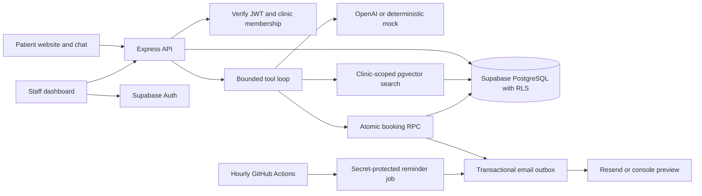

# ClinicDesk AI

A small clinic’s front desk, one conversation away. ClinicDesk AI is a full-stack portfolio project for a fictional CareWell Family Clinic in Lahore: patients ask questions grounded in clinic documents, find appointment times, explicitly confirm a booking, and leave enquiries for staff. The clinic team gets a private dashboard for appointments, leads, transcripts and AI usage. Transactional email delivery, automated reminders, tenant isolation and a deterministic no-key demo make the engineering inspectable as well as presentable.

**Live demo:** _Add the deployed Render web URL here after configuring your services._

**Screenshots:** _Add a desktop clinic-page screenshot, mobile chat screenshot and staff-dashboard screenshot here after deployment._

## Run locally — five commands

Prerequisites: Node.js **20.19+ within the 20.x release line** and npm. `.nvmrc` selects Node 20; if you use nvm, run `nvm install` / `nvm use` first.

```sh
cd ~/Desktop/ClinicDeskAI
npm ci
cp .env.example .env
npm run seed
npm run dev
```

Open **http://localhost:5173**. The API runs on **http://localhost:3001**. The default environment uses deterministic mock AI, in-memory auto-seeded data and console email previews. No API keys or Docker are needed. Demo data resets whenever the server restarts; it is not a database substitute for deployment.

Try **Opening hours**, **Fees**, then **Book an appointment**. Select a time, enter fictional contact details, review every field, and select **Confirm booking**. In `/admin/login`, choose **Open local demo dashboard**. The demo token is accepted only by the local in-memory adapter; production rejects demo mode at startup.

To use Supabase locally, apply the migrations below, set `DEMO_MODE=false`, configure the public and server keys, set `SEED_STAFF_EMAIL` / `SEED_STAFF_PASSWORD`, and rerun `npm run seed`. Keep `MOCK_LLM=true` if you want to test the real database without OpenAI costs. `MOCK_LLM` controls AI; `DEMO_MODE` independently controls storage.

## Features

- Clinic-specific RAG: OpenAI embeddings, pgvector cosine search and up to four retrieved chunks.
- Five validated tools: knowledge search, availability, booking, lead capture and human handoff.
- Five-iteration agent loop, serialized conversation turns and safe provider-error responses.
- Server-enforced review and explicit confirmation before any booking; atomic slot allocation returns **409** on conflict.
- Confirmation emails in a transactional outbox, stable Resend idempotency keys and hourly retry/reminder automation.
- Reminder eligibility **23–25 hours** ahead; successful sends record `reminder_sent_at`.
- Supabase email/password login, verified JWTs, staff membership checks and RLS on every application table.
- Paginated appointments, leads and conversations, transcript pagination, usage totals and a requests-per-day chart.
- Responsive CSS modules, accessible labels, keyboard dismissal, live chat announcements and reduced-motion support.
- Twelve fictional clinic markdown documents, future half-hour slots for 14 dates (9am–5pm, Monday–Saturday) and a staff-user seed.

## Stack and structure

Node 20, Express, TypeScript, zod, pino, helmet, cors, express-rate-limit; Supabase PostgreSQL/pgvector/Auth; official OpenAI Node SDK; Resend; React, Vite, React Router and CSS modules. Jest/Supertest and Vitest/React Testing Library provide tests. Docker, GitHub Actions, Render and k6 cover delivery and verification.

```text
server/src/             API, repositories, AI adapters, tool loop and email delivery
server/seed/            Idempotent Supabase seed and 12 clinic documents
server/test/            API, adapter and real SQL/RLS tests
web/src/                Clinic website, chat widget and staff dashboard
supabase/migrations/    Ordered SQL schema, policies, RPCs and usage aggregation
load/                   k6 scenario and checked-in benchmark summary
docs/                   Architecture, validation log and verification limits
.github/workflows/      CI and hourly reminder job
```



## Environment variables

Copy `.env.example` to `.env`; it lists every variable with comments. Root `.env` is read by backend dev/seed scripts and Vite. Never commit it. All `VITE_` values become public browser code; only the Supabase **anon** key belongs there.

| Variables                                                                                              | Purpose                                                                                                                                                    |
| ------------------------------------------------------------------------------------------------------ | ---------------------------------------------------------------------------------------------------------------------------------------------------------- |
| `NODE_ENV`, `PORT`, `LOG_LEVEL`                                                                        | Backend mode, port (3001) and pino level. Production web builds explicitly set `NODE_ENV=production`.                                                      |
| `WEB_ORIGIN`                                                                                           | Exact allowed web origin, including scheme and port locally.                                                                                               |
| `TRUST_PROXY_HOPS`                                                                                     | 0 directly, 1 behind Render’s proxy. Do not blindly trust all proxies.                                                                                     |
| `MOCK_LLM`                                                                                             | `true` replaces both chat completions and embeddings with deterministic fakes.                                                                             |
| `DEMO_MODE`                                                                                            | `true` uses volatile local storage and enables the local staff token. Forbidden with production mode.                                                      |
| `SUPABASE_URL`, `SUPABASE_SERVICE_ROLE_KEY`                                                            | Server database/Auth access. Required with real storage; service key is server-only.                                                                       |
| `OPENAI_API_KEY`                                                                                       | Required only for live AI.                                                                                                                                 |
| `OPENAI_MODEL`                                                                                         | Chat model, default `gpt-4o-mini`; choose a model that supports function calling.                                                                          |
| `OPENAI_EMBEDDING_MODEL`                                                                               | Defaults to `text-embedding-3-small`; the schema requires 1536 dimensions.                                                                                 |
| `OPENAI_INPUT_COST_PER_MILLION`, `OPENAI_OUTPUT_COST_PER_MILLION`, `OPENAI_EMBEDDING_COST_PER_MILLION` | Current USD token prices for the selected models. Defaults are unconfigured zero; the dashboard labels missing configuration. Mock calls always cost zero. |
| `RESEND_API_KEY`, `EMAIL_FROM`                                                                         | Email credentials and a verified sender. Missing key prints previews instead of delivering mail.                                                           |
| `CRON_SECRET`                                                                                          | At least 24 characters; use a random production secret. The local default is rejected in production.                                                       |
| `CHAT_RATE_LIMIT`                                                                                      | Requests/minute/IP, default 20. Raise only on an isolated mock load-test server.                                                                           |
| `VITE_API_URL`                                                                                         | API base URL; empty locally uses Vite’s `/api` proxy.                                                                                                      |
| `VITE_CLINIC_ID`                                                                                       | Public clinic UUID. Default demo UUID: `11111111-1111-4111-8111-111111111111`.                                                                             |
| `VITE_DEMO_MODE`                                                                                       | Show the local demo login option. Must be false on deployed web builds.                                                                                    |
| `VITE_SUPABASE_URL`, `VITE_SUPABASE_ANON_KEY`                                                          | Public Supabase client configuration for staff login.                                                                                                      |
| `VITE_PROXY_TARGET`                                                                                    | Local proxy target, default `http://127.0.0.1:3001`; Compose sets `http://server:3001`.                                                                    |
| `SEED_STAFF_EMAIL`, `SEED_STAFF_PASSWORD`                                                              | Seed-only staff credentials; password must be at least 12 characters. Existing users are reused without resetting their password.                          |

The seed upserts clinic/documents, preserves existing slots/bookings, and generates embeddings in the selected mode. **When switching between mock and live AI, rerun the seed to regenerate all document embeddings in the same embedding space as queries.** The seed can be run again to extend the slot horizon; it does not implement a perpetual scheduling service.

## Supabase and deployment

1. Create a Supabase project. Apply both SQL files in `supabase/migrations` in filename order using the SQL editor, or use the Supabase CLI (`supabase link --project-ref YOUR_REF` then `supabase db push`). The migration creates the `vector` extension in `extensions`.
2. Configure real-storage environment variables and run `npm run seed`. The seed creates the fictional clinic, documents, future slots and one confirmed Auth staff account. Add additional staff with Auth admin tools and provision `staff_profiles` using trusted administrative access. Staff cannot self-assign a clinic.
3. Create a GitHub repository and push this Git history. No remote repository is created or pushed automatically by this project.
4. In Render, create a Blueprint from `render.yaml`. It defines a **paid starter Docker API service** and a static web app. Review the selected plan before creating services. For the API, set Supabase service credentials, exact `WEB_ORIGIN`, sender and optional live AI/email keys. Render generates `CRON_SECRET`. Keep `DEMO_MODE=false`.
5. For the web app, set `VITE_API_URL` to the API HTTPS URL, Supabase public URL/anon key, the seeded clinic UUID and `VITE_DEMO_MODE=false`. Rebuild after changing any `VITE_` variable. The rewrite rule supports deep links such as `/admin/login`.
6. For real AI, set `MOCK_LLM=false`, configure the model/key and current cost rates, and reseed live embeddings. Configure a verified Resend sender/API key for actual patient emails; otherwise notifications remain console previews.
7. In GitHub repository secrets, set **`CLINICDESK_API_URL`** to the API origin and **`CRON_SECRET`** to the same value as Render. Enable Actions and trigger **Appointment reminders** manually once. It then runs hourly at minute 17. GitHub schedules can be delayed; the eligibility window tolerates normal drift but is not an SLA.

Supabase migrations are an explicit deployment step, not a server-start side effect. Real service access and cloud deployment need your accounts/keys; no live URL, email delivery or cloud migration is claimed until those are configured.

### Docker development

```sh
docker compose up --build
```

Use the same root `.env`; Compose runs the Docker API and Vite web server. Supabase remains an external/local-Supabase service rather than being replaced by a plain PostgreSQL container. The API Dockerfile has a build stage, pruned production dependencies, a non-root runtime user and a health check. Never put keys in the image. Docker startup was not exercised on the build machine because its Docker daemon was unavailable.

## Tests and CI

```sh
npm run lint
npm run typecheck
npm run test:coverage
npm run build
```

CI runs these commands on Node 20 for every push and pull request, prints coverage, and uploads both coverage reports. Server tests force `MOCK_LLM=true` and use a fresh repository; they need no API keys. Test-only **PGlite** executes the actual PostgreSQL migrations and pgvector/RLS/RPC assertions without Docker. It does not replace Supabase in the application.

**Measured coverage:** **97.16% server line coverage** (514/529 lines), including every file under `server/src`; **68 server tests and 7 frontend tests passed**. See [milestone verification](docs/MILESTONES.md) and [verification limits](docs/VERIFICATION.md). Tests cover validation, sourced answers, complete confirmed booking/email flow, duplicate booking conflicts, rate limits, missing/invalid admin tokens, clinic isolation, reminder authorization/window/retries and no-resend behavior. Adapter tests exercise the real SDK clients against fake HTTP responses; no test sends a real email or calls OpenAI.

### k6 load test

Install k6 from its [official installation instructions](https://grafana.com/docs/k6/latest/set-up/install-k6/). In terminal one, run the compiled, isolated mock server:

```sh
npm run build -w server
MOCK_LLM=true DEMO_MODE=true CHAT_RATE_LIMIT=10000 PORT=3002 LOG_LEVEL=silent node server/dist/index.js
```

In terminal two, from the repository root:

```sh
k6 run load/chat.js
```

The scenario ramps **0 → 50 virtual users over one minute**. Every iteration checks health, asks a new clinic-hours question and waits one second. It refuses to run unless health reports mock AI. `BASE_URL` and `CLINIC_ID` can override the defaults. Thresholds require <1% errors, chat p95 <1500ms and health p95 <500ms. `load/results.json` contains the full local output and is intentionally ignored; `load/benchmark.json` preserves the reviewed summary.

Measured **2 November 2026**, macOS arm64 loopback, Node 20.20.2, k6 1.8.2; mock AI and in-memory data. All configured k6 thresholds passed.

| Metric                 |     Measured result |
| ---------------------- | ------------------: |
| Ramp duration / target | 60 seconds / 50 VUs |
| HTTP requests          |               2,981 |
| Health p95             |             1.53 ms |
| Chat p95               |             2.24 ms |
| Overall HTTP p95       |             2.07 ms |
| Application error rate |               0.00% |
| HTTP failure rate      |               0.00% |

This is a local **mock AI + memory** benchmark, not a claim about Supabase, OpenAI, Resend or internet performance. It measures API overhead, local retrieval and the agent/tool plumbing. Measure those deployed services separately with a controlled budget and real credentials.

## Security and operational limits

- RLS is enabled on all ten application tables. Staff read/write policies are clinic-scoped; membership, usage audit records and email processing are deliberately more restricted. Service-role endpoints independently scope every patient operation to the validated clinic and conversation.
- Booking uses an atomic conditional update, a unique appointment slot and a same-transaction email outbox. Public callers cannot execute the booking or outbox RPCs directly. A lost HTTP response after a committed booking may require reception to verify it; automatic retries never create a duplicate for the same slot.
- Conversations use unpredictable UUIDs as bearer capabilities and a database lease to prevent simultaneous turns. Keep IDs private; clearing/restarting chat removes the browser’s handle. There is no authenticated patient portal or patient identity verification.
- zod validates requests/tool arguments; JSON bodies are capped at 16KB. Helmet, an exact CORS allowlist, private cron secret and per-IP chat limiting are enabled. The default rate-limit store is per process; use one API instance until a shared limiter is added.
- Retrieved text is marked as untrusted data in the system prompt, and explicit code checks handle emergency phrases and selected medical-advice requests. These guardrails are not clinical validation or a guarantee against all model errors. This portfolio is a fictional clinic and should not receive real medical information.
- Logs exclude request bodies/tokens. **Console email preview mode contains the email content**, so use fictional data and protect logs. Configure Resend for delivery and review your hosting/provider retention and privacy requirements before any real clinic use.
- Provider idempotency keys and leased outbox claims prevent normal overlapping sends. A crash after provider acceptance is retried with the same key. Provider idempotency retention is finite; there is no claim of unconditional exactly-once external delivery.
- Admin responses are `Cache-Control: no-store`. Only anon/public Supabase configuration goes to the browser. HTTPS, verified email domains, access review, data retention and backups are deployment responsibilities.
- Dependency audit on 2 November 2026: **zero production advisories**, and no high/critical findings in the full tree. Twenty transitive development-tool findings remain (17 moderate, 3 low), in the Jest/coverage dependency tree. See `docs/VERIFICATION.md`; no unsupported major-version rewrites or misleading “all clear” claim are used.

## Future work

A shared rate limiter and worker queue for multiple API instances; stronger conversation capabilities and patient verification; appointment cancellation/rescheduling; perpetual slot generation, holidays and clinician calendars; document ingestion/versioning; outreach delivery status in the dashboard; retention/deletion controls; adversarial RAG evaluation; live-provider and deployed performance checks. These are explicit extensions, not unfinished branches in the shipped implementation.

Read [ARCHITECTURE.md](docs/ARCHITECTURE.md) for a concise interview walkthrough of the design and trade-offs.
